<!-- OR7 / GITHUB PROFILE • VIOLET FLOW -->
<div align="center">

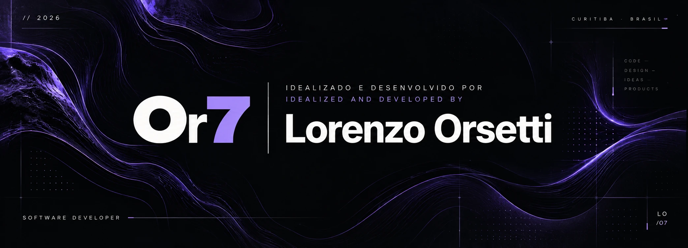

<h3>Software Developer ✦</h3>

<p>Software Engineering · PUCPR · Curitiba, Brazil</p>

<a href="https://lorenzo-or7.github.io/">
  
</a>
&nbsp;
<a href="https://www.linkedin.com/in/lorenzo-orsetti-031906349/">
  
</a>
&nbsp;
<a href="mailto:lmorsetti@gmail.com">
  
</a>

</div>

<hr>

<h2>01 / About Me</h2>

```javascript
const lorenzo = {
  name: "Lorenzo Orsetti",
  role: "Software Developer",
  education: "Software Engineering",
  university: "PUCPR",
  location: "Curitiba, Brazil",
  focus: ["Web Applications", "UI/UX", "Digital Products"]
};
```

### Hi, I'm Lorenzo. ✦

I'm a Software Engineering student at PUCPR, focused on developing web applications and thoughtful digital experiences. I build personal software products and commercial website prototypes, combining frontend development, backend functionality and interface design.

<details>
<summary><strong>🇧🇷 Ler em português</strong></summary>

Sou estudante de Engenharia de Software na PUCPR, com foco no desenvolvimento de aplicações web e experiências digitais bem planejadas. Crio produtos de software autorais e protótipos de sites comerciais, combinando desenvolvimento frontend, funcionalidades backend e design de interfaces.

</details>

---

## 02 / Tech Stack

**Frontend Development**

  

**Backend & Programming**

 

**Database & Cloud**

  

**Development Tools**

  

**AI & Development Assistants**

    

> Tools and technologies I've worked with, including AI-assisted development tools. Listed tools do not imply equal proficiency.

---

## 03 / Featured Projects

A selection of projects focused on real-world problems, product thinking and interface design.

<a href="https://planosdegoverno.com.br/">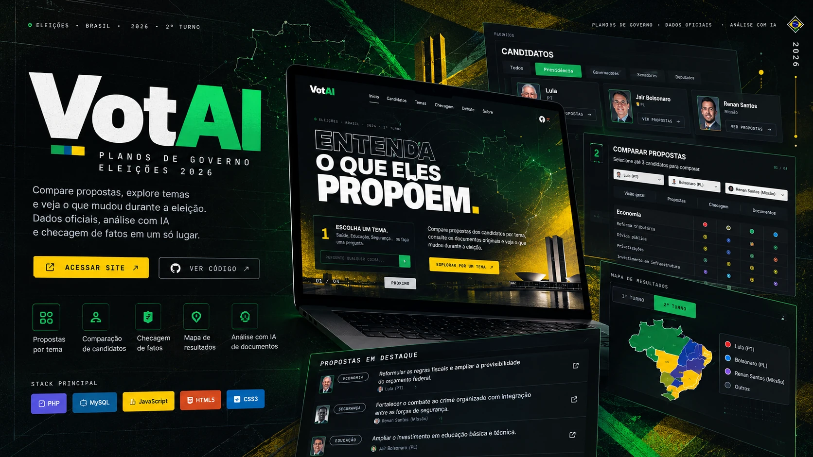</a>

### 01 &nbsp; VotAI

<sub>CIVIC TECHNOLOGY &nbsp; · &nbsp; Public project</sub>

Explore and compare electoral proposals using their original documents and traceable sources.

`PHP · MySQL · JavaScript`

<a href="https://planosdegoverno.com.br/">
  
</a>
&nbsp;
<a href="https://github.com/lorenzo-or7/VotAI">
  
</a>

<br>

---

<br>

<a href="https://nexo-gamma-one.vercel.app/">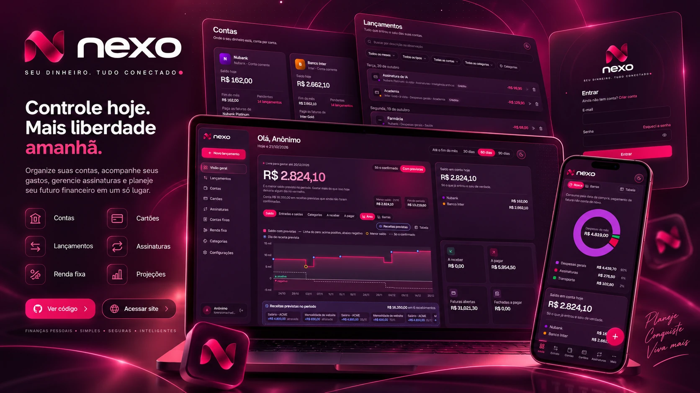</a>

### 02 &nbsp; NEXO

<sub>PERSONAL FINANCE &nbsp; · &nbsp; Live web application</sub>

Track accounts, credit cards, subscriptions, expenses and future financial projections in one place.

`Personal finance · Web application`

<a href="https://nexo-gamma-one.vercel.app/">
  
</a>

<br>

---

<br>

<a href="https://lorenzo-or7.github.io/duskdex/">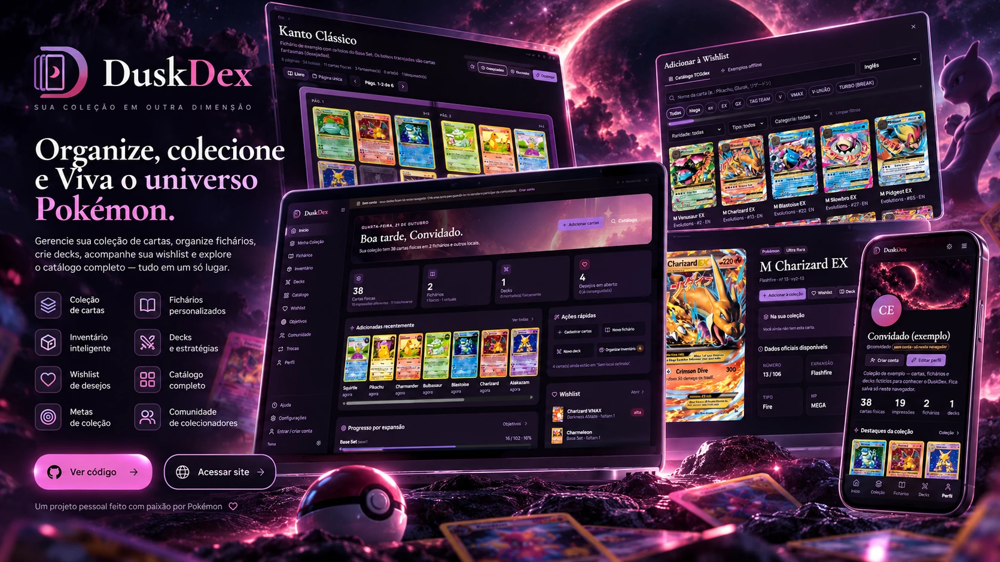</a>

### 03 &nbsp; DuskDex

<sub>COLLECTION MANAGEMENT &nbsp; · &nbsp; Public demo</sub>

Organize Pokémon TCG cards, binders, decks, inventory and wishlists in a unified collection experience.

`Pokémon TCG · Web application`

<a href="https://lorenzo-or7.github.io/duskdex/">
  
</a>
&nbsp;
<a href="https://github.com/lorenzo-or7/duskdex">
  
</a>

<br>

---

<br>

<a href="https://lorenzo-or7.github.io/saiso-demo/">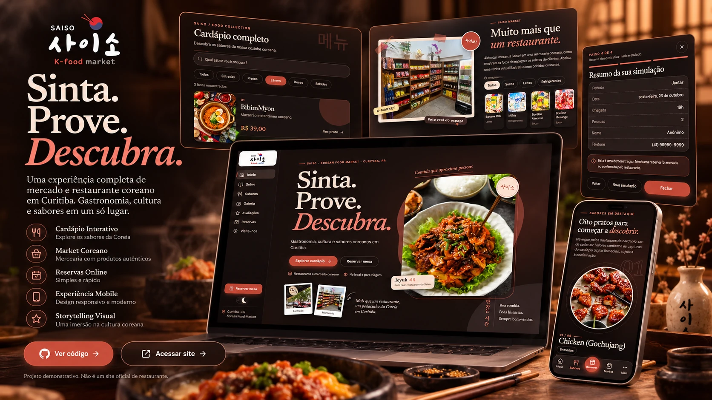</a>

### 04 &nbsp; Saiso

<sub>RESTAURANT EXPERIENCE &nbsp; · &nbsp; Concept / demo — no actual reservations</sub>

A Korean food market website concept with an interactive menu, product showcase and reservation simulation.

`Restaurant · UI/UX`

<a href="https://lorenzo-or7.github.io/saiso-demo/">
  
</a>

<br>

---

<br>

<a href="https://lorenzo-or7.github.io/barbearia-chapula-demo/">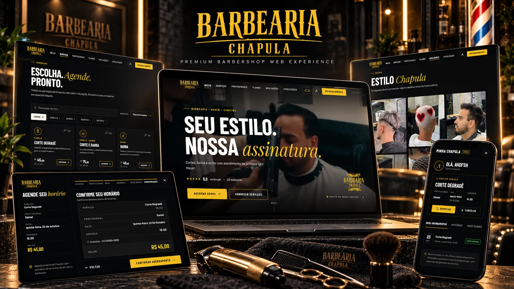</a>

### 05 &nbsp; Barbearia Chapula

<sub>BARBERSHOP EXPERIENCE &nbsp; · &nbsp; Concept / demo</sub>

A premium barbershop website concept with service listings, professional profiles and demonstration booking.

`Commercial website · UI/UX`

<a href="https://lorenzo-or7.github.io/barbearia-chapula-demo/">
  
</a>
&nbsp;
<a href="https://github.com/lorenzo-or7/barbearia-chapula-demo">
  
</a>

<br>

---

## 04 / More Projects

Additional work across small businesses, experiments, hospitality and digital services.

| | |
|:---:|:---:|
| <a href="https://lorenzo-or7.github.io/retrama/">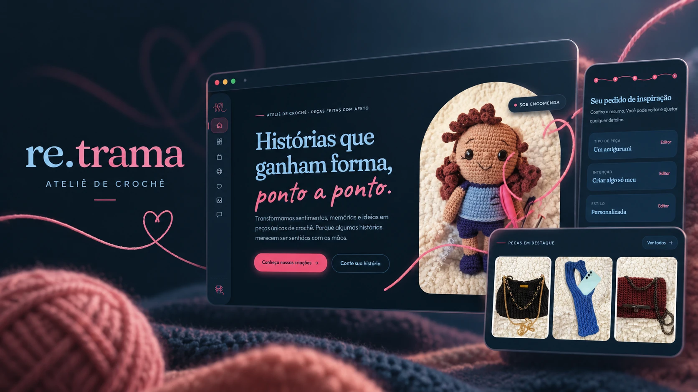</a><br><strong>re.trama</strong><br><sub>Crochet atelier & handmade products</sub><br><br><a href="https://lorenzo-or7.github.io/retrama/"></a> | <a href="https://lorenzo-or7.github.io/mkt/">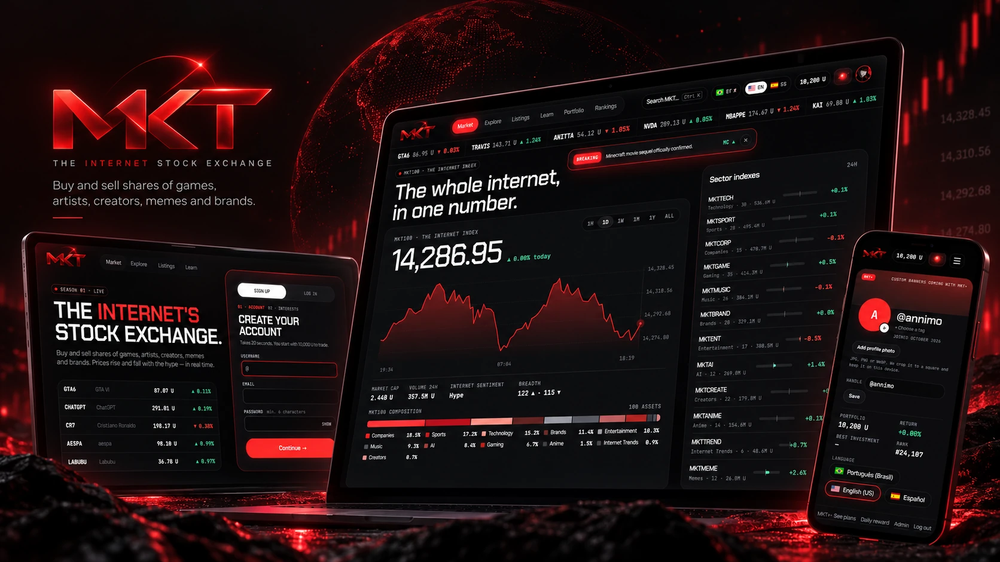</a><br><strong>MKT</strong><br><sub>Fictional internet culture market · no real money</sub><br><br><a href="https://lorenzo-or7.github.io/mkt/"></a> |
| <a href="https://lorenzo-or7.github.io/namba-demo/">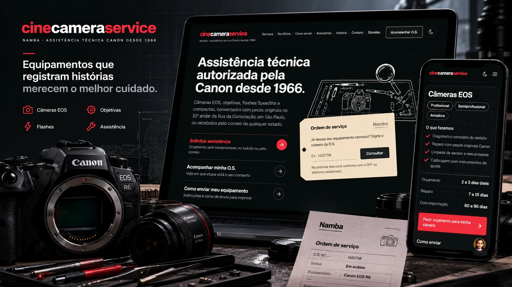</a><br><strong>Cine Camera Service</strong><br><sub>Camera repair & service-order experience</sub><br><br><a href="https://lorenzo-or7.github.io/namba-demo/"></a> | <a href="https://lorenzo-or7.github.io/contlup-demo/">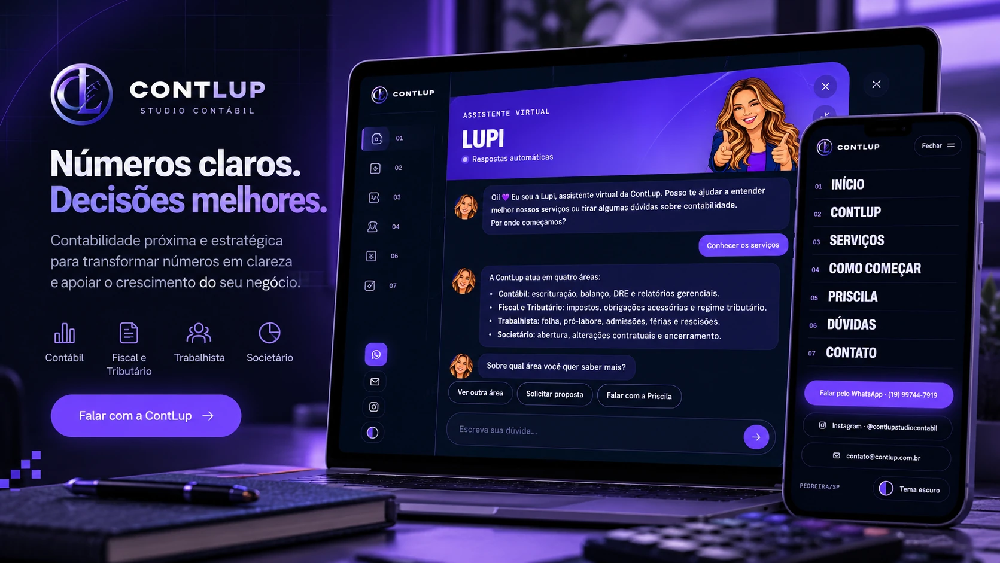</a><br><strong>ContLup</strong><br><sub>Accounting website & virtual assistant</sub><br><br><a href="https://lorenzo-or7.github.io/contlup-demo/"></a> |
| <a href="https://lorenzo-or7.github.io/studio-astra-demo/">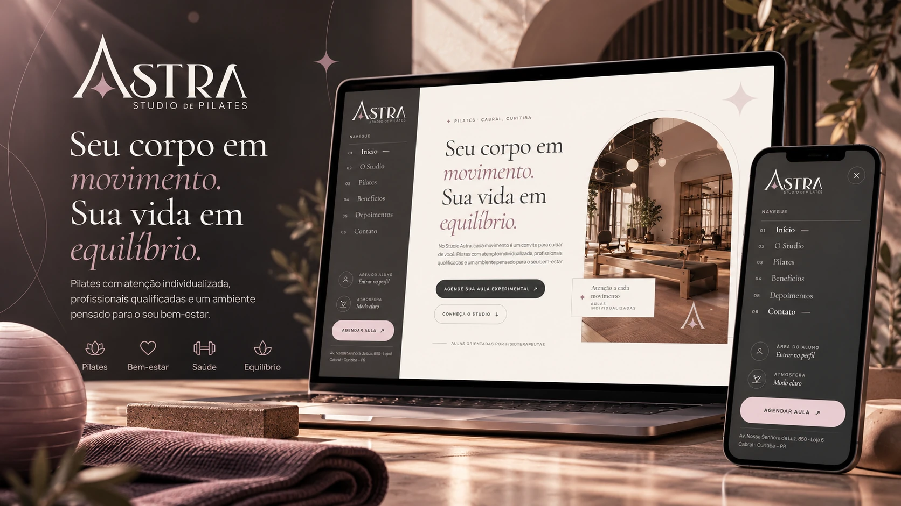</a><br><strong>Studio Astra</strong><br><sub>Pilates studio website concept</sub><br><br><a href="https://lorenzo-or7.github.io/studio-astra-demo/"></a> | <a href="https://lorenzo-or7.github.io/capim-leao-demo/">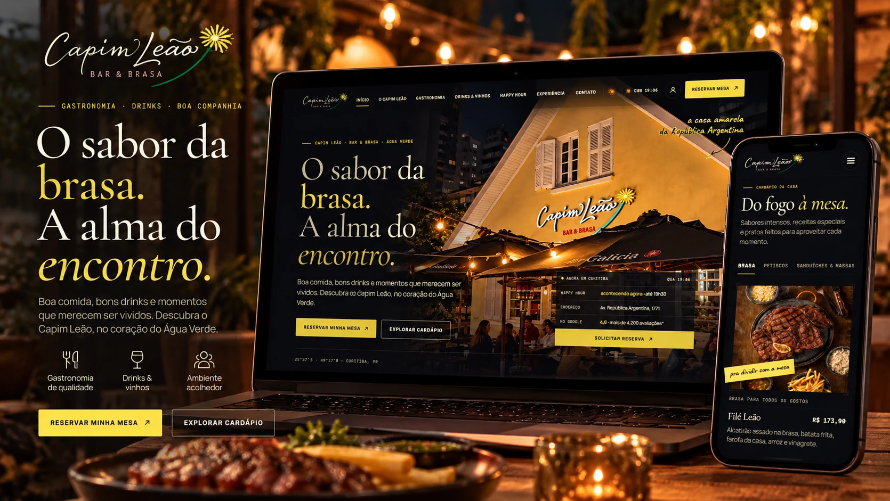</a><br><strong>Capim Leão</strong><br><sub>Restaurant & bar website concept</sub><br><br><a href="https://lorenzo-or7.github.io/capim-leao-demo/"></a> |
| <a href="https://lorenzo-or7.github.io/eloplus-demo/">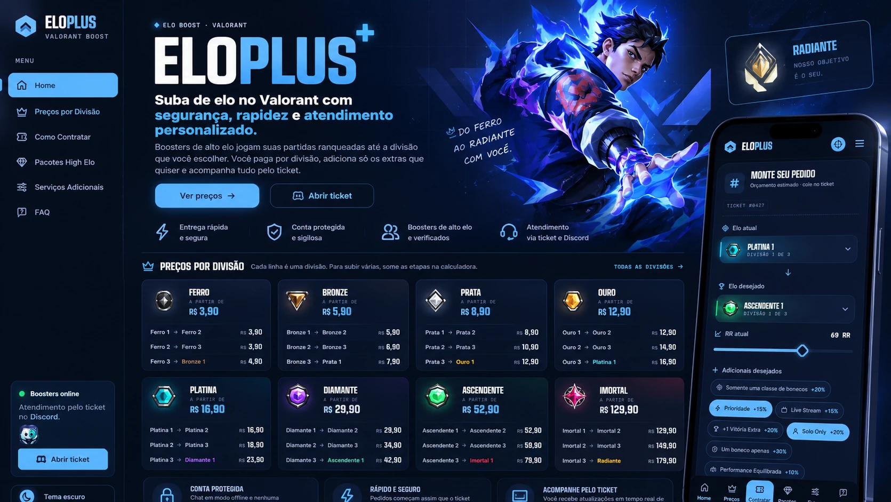</a><br><strong>EloPlus</strong><br><sub>Valorant service website concept</sub><br><br><a href="https://lorenzo-or7.github.io/eloplus-demo/"></a> | <a href="https://lorenzo-or7.github.io/maca-padaria-demo/">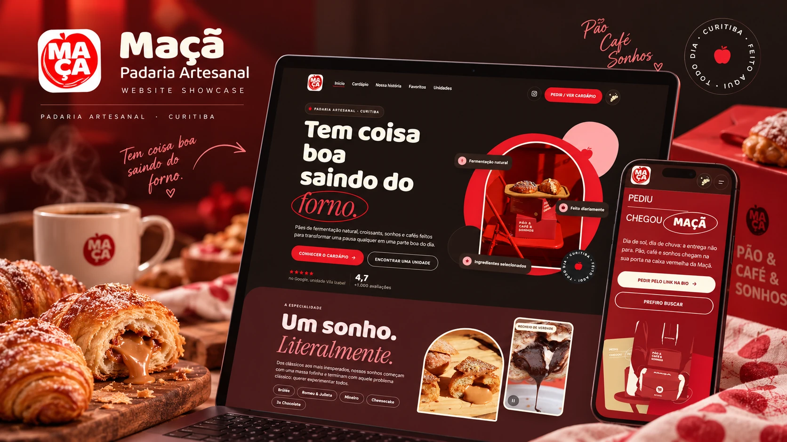</a><br><strong>Maçã Padaria</strong><br><sub>Artisan bakery website concept</sub><br><br><a href="https://lorenzo-or7.github.io/maca-padaria-demo/"></a> |


<div align="center">
<br>
<a href="https://lorenzo-or7.github.io/">
  
</a>
<br>
</div>

---

## 05 / Connect With Me

<div align="center">

### Let's build something meaningful.

Open to development opportunities, collaborations and new projects.

[](https://www.linkedin.com/in/lorenzo-orsetti-031906349/)
[](https://lorenzo-or7.github.io/)
[](https://github.com/lorenzo-or7)
[](mailto:lmorsetti@gmail.com)

---


<div align="center">

  

</div>


</div>
